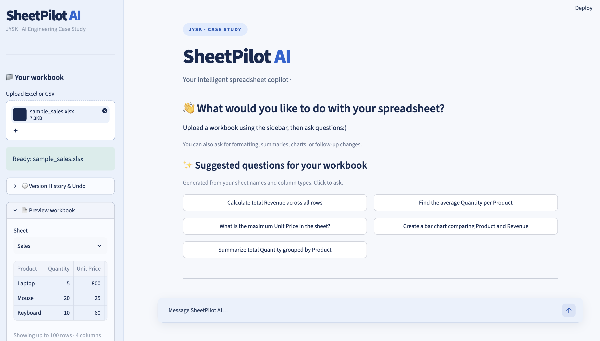
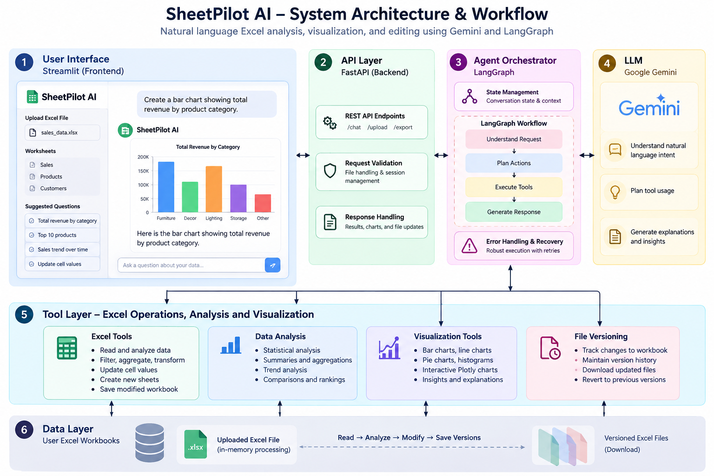

# SheetPilot AI
### Agentic Excel Assistant | 

SheetPilot AI is a conversational Excel assistant that allows users to **analyze, visualize, and modify Excel workbooks using natural language**.

It combines **Google Gemini, LangGraph, FastAPI, Streamlit, and Python-based Excel tools** to transform user instructions into validated spreadsheet operations.

The key design principle is simple: **the LLM decides what to do, while deterministic Python tools perform the actual workbook operations.**

## Application Preview



*SheetPilot AI demonstrating natural-language spreadsheet analysis, interactive visualization, and workbook editing.*
## 1. Key Features

### Conversational Excel Assistant
- Upload Excel workbooks and interact through natural-language chat.
- Explore worksheets, columns, data types, and sample records.
- Ask analytical questions and receive contextual responses.
- Maintain conversation context for follow-up instructions.
- Display clickable, file-aware suggested questions after upload.

### Excel Editing & Automation — Phase 8.3
- Create, rename, and manage worksheets.
- Add, update, and delete rows or columns.
- Find and replace values.
- Filter and manipulate spreadsheet data.
- Create calculated columns and apply Excel formulas.
- Apply formatting and perform supported workbook transformations.
- Save changes and download the updated Excel file.

### Interactive Visualization — Phase 8.1
- Generate charts and plots through natural-language instructions.
- Display visualizations directly inside the Streamlit conversation.
- Embed supported charts into downloadable Excel workbooks.
- Explore spreadsheet data visually without writing code.

### Workbook Safety & Versioning
- Preserve workbook changes across multiple instructions.
- Maintain workbook versions for recovery.
- **Undo** previous changes.
- **Restore** an earlier workbook version.
- Execute operations on a workbook copy to prevent partially committed changes.

### Agent Reliability
- Structured LLM-generated execution plans.
- Tool argument validation before execution.
- Automatic replanning and bounded retries.
- Conversation-aware execution.
- Structured logging for execution outcomes, failures, and latency.

## 2. Technology Stack

| Component | Technology |
|---|---|
| LLM | Google Gemini |
| Agent orchestration | LangGraph |
| Backend API | FastAPI, Pydantic |
| Frontend | Streamlit |
| Excel processing | openpyxl, pandas |
| Visualization | Python charting tools |
| State management | Conversation memory, workbook versioning |
| Testing | pytest |
| Observability | Structured Python logging |

## 3. System Architecture

## System Architecture



The architecture separates AI-driven planning from deterministic Excel execution.

**Workflow:** Streamlit → FastAPI → LangGraph → Gemini Planning → Tool Validation → Excel Operations → Workbook Versioning → Results.

The system supports conversational spreadsheet analysis, Excel editing, interactive visualizations, error recovery, and Undo/Restore functionality.

The agent follows a controlled execution workflow:

```text
                    USER
                     |
             Streamlit Chat UI
                     |
             FastAPI Backend
                     |
              LangGraph Agent
                     |
              Gemini Planner
                     |
             Plan Validation
                     |
             Excel Tool Registry
                     |
         Deterministic Python Tools
                     |
          Updated Excel Workbook
                     |
          Versioning & Persistence
                     |
       Response + Charts + Download
```

### How It Works

1. **Upload:** The user uploads an Excel workbook through Streamlit.
2. **Understand:** The backend extracts workbook metadata and conversation context.
3. **Plan:** Gemini generates a structured plan using supported Excel tools.
4. **Validate:** Pydantic schemas and tool-specific checks validate the proposed actions.
5. **Execute:** LangGraph invokes deterministic Python tools.
6. **Recover:** Invalid plans or failed operations can trigger bounded retries.
7. **Persist:** Successful changes are saved, with workbook history supporting Undo and Restore.
8. **Respond:** The user receives an explanation, updated workbook, and visualizations when requested.

**Why this architecture?**

It separates flexible AI reasoning from controlled execution, improving reliability, maintainability, and transparency.

## 4. Example Use Cases

After uploading an Excel workbook, users can ask:

**Data exploration**
> Show me the available worksheets and their columns.

**Data analysis**
> Calculate total revenue by product category.

**Excel automation**
> Create a Revenue column using Quantity multiplied by Unit Price.

**Data manipulation**
> Find and replace missing category values with "Unknown".

**Visualization**
> Create a bar chart showing revenue by category.

**Workbook management**
> Undo my last change.

> Restore the previous workbook version.

The assistant processes these requests through its supported tools and returns results within the conversation.

## 5. Getting Started

### Prerequisites

- Python 3.12
- Google Gemini API key
- `uv` package manager

### Installation

Clone the repository:

```bash
git clone https://github.com/PrinceSharmaa/SheetPilotAI.git

cd SheetPilotAI
```

Install dependencies:

```bash
uv sync
```

### Environment Configuration

Create a `.env` file in the project root:

```env
GEMINI_API_KEY=your_gemini_api_key
BACKEND_URL=http://127.0.0.1:8000
```

Never commit API keys or `.env` files.

### Start the Backend

```bash
uv run python -m uvicorn backend.app.main:app --reload --port 8000
```

API documentation is available at `http://127.0.0.1:8000/docs`.

### Start the Frontend

Open another terminal:

```bash
uv run streamlit run frontend/app.py
```

Open the local Streamlit URL displayed in your terminal.

## 6. Testing & Reliability

The project includes automated tests covering:

- Agent planning and validation
- Excel tool execution
- API behavior
- Workbook persistence
- Transactional execution
- Error handling and recovery
- Observability
- Workbook versioning and restoration

Run the tests:

```bash
uv run python -m pytest backend/tests -q
```

**Local test result: 110 tests passed.**

The application also uses bounded retries and structured execution logs to support debugging and recovery.

## 7. Engineering Decisions

| Design Decision | Reason |
|---|---|
| Gemini for planning | Understands natural-language spreadsheet instructions |
| LangGraph orchestration | Provides controlled execution and retry workflows |
| Structured tool calls | Reduces unsupported or invalid operations |
| Deterministic Excel tools | Makes workbook modifications predictable |
| Transactional execution | Avoids committing partially failed changes |
| Workbook versioning | Supports Undo and Restore |
| Interactive charts | Makes analytical results immediately accessible |
| FastAPI + Streamlit | Separates backend logic from the user interface |

## AI Assistance, Engineering Practices & Assumptions

**AI Assistance:** AI tools were used for technical research, selected code suggestions, debugging, and documentation refinement. AI-assisted contributions were reviewed through local execution and automated testing.

**Engineering Practices:** The application follows a modular architecture using FastAPI, LangGraph, and deterministic Excel tools. Structured validation, bounded retries, transactional execution, logging, and workbook versioning were implemented to support reliability, maintainability, and recovery.

**Assumptions:** The solution was designed as a local prototype using Gemini for natural-language planning and Python tools for spreadsheet operations. Local storage and conversation context were chosen for simplicity and reproducibility. Authentication, persistent multi-user storage, and cloud deployment remain future production considerations.

## 8. Limitations & Future Improvements

SheetPilot AI is a **functional local prototype**.


Potential improvements include persistent multi-user sessions, authenticated workbook storage, expanded spreadsheet compatibility, CI/CD deployment, and production-level LLM evaluation and monitoring.

## 9. Assignment Summary

**SheetPilot AI demonstrates an end-to-end agentic AI application**, combining LLM-based reasoning with validated tool execution, conversational interaction, Excel automation, interactive visualization, and workbook recovery.

The objective is not simply to generate spreadsheet answers, but to build an AI assistant that can **safely execute useful spreadsheet operations while maintaining user control over changes**.

---

**Developed independently.**
